# UI mockup review: implementation against draft

As of: 2026-11-05 · Branch `fix/ui-mockup-parity` (from `feat/integration`) · Draft: Claude artifact `EXj4fJ9FsvkUjZ3o5hVEcM` (version `1793857819-9d47`, 16 boards) · Authoritative on deviations: `docs/ui-comparison.md` and `docs/spec.md` v0.6. Deferred items: [`docs/backlog/ui-deferred.md`](backlog/ui-deferred.md). The draft artifact is no longer readable; `docs/ui-review/` holds the reference screenshots.

Language: this document is English; the drafts and the product UI are German, so UI labels are quoted in German.

## Approach and limits

- The boards (`*.dc.html`) originally run in the runtime of the artifact type, which was not available for the review. They were rendered with a small renderer of our own (`sc-for`, `sc-if`, `{{…}}`, input of the `renderVals` script), Inter and JetBrains Mono from `@fontsource-variable` like in the app. The sidebar logic was rebuilt once and inserted into all boards; `DashboardCollapsed` corresponds to `Dashboard` with `collapsed=true` and was rendered that way.
- The implementation was checked against the MSW mock build (`pnpm ui:build`, seed data, role admin) in Chromium; desktop 1440 px (factor 1) and mobile 390 px (factor 2). 1280 px was checked via the Playwright tests (default window of the E2E tests), not stored as an image pair.
- Image pairs are in `docs/ui-review/<page>-{mockup,impl,impl-after}.png` (`impl` = before, `impl-after` = after the fixes), mobile as `<page>-m-…`. The images are quantized to 48 colors and cropped at the top for very long pages (desktop 2400 px, mobile 3200 px). The mock bar "Mock-Modus" at the top of `impl`/`impl-after` is part of the mock build and not a finding.
- The draft shows no empty, loading and error states (comparison section 1). The implementation has them; examples: `dashboard-empty`, `dashboard-error`, `upstreams-empty`, `upstreams-error`, `audit-empty`, `tokens-empty`, `stats-error`, `login` (each `-impl-after.png`). A comparison is not possible for them.
- For login, registration, accepting an invitation, password reset, `/link/done` there is no draft ("no draft" in the comparison). They were not compared.
- Not measured: pixel spacing per element down to the detail (the draft's dimensions match in the sample: h1 20 px/600, cards radius 10, inputs 44 px, sidebar 248/64 px), dark mode (phase 2), animations and hover states, keyboard navigation (covered by `ui:e2e`).

## Deliberately omitted per ui-comparison.md (do not align)

Tags and device names (decision 7); "Alle testen" until the confirmation variant (7); dark mode and "System" (8); admin scope in the consent until phase 2 (5); "online/verbunden seit/Sitzung offen" → Aktiv/Inaktiv, "Zuletzt aktiv" (W7); change email, notification mails, delete account (3); KPIs, charts, availability, heatmap, latency series, errors by kind until phase 2 (4, 7); tabs "Aufrufe" and "Anmeldung" (no data model); meta-tool mode in clients and JSON import (phase 3); REST and OAuth as upstream type/sign-in in phase 1; status labels In Ordnung/Eingeschränkt (W1); scope names `mcp:tools` (W2); invitation link with allowlist switch is dropped (2); path `/data/stdio/…` from the server (W14); mobile off-canvas instead of a horizontal bar is fixed in the plan (`frontend.md`, section mobile) and noted there for confirmation.

## Summary

| Page | fix | deliberate | decision needed |
|---|---:|---:|---:|
| Dashboard (+ collapsed) | 1 | 5 | 1 |
| Upstreams (list) | 3 | 4 | 2 |
| Upstream detail | 2 | 4 | 3 |
| Add upstream | 2 | 4 | 0 |
| stdio approval | 0 | 3 | 1 |
| Auth link: enter token | 1 | 2 | 0 |
| OAuth consent | 0 | 3 | 0 |
| Statistics | 4 | 2 | 1 |
| Clients | 1 | 2 | 0 |
| Personal access tokens | 2 | 0 | 0 |
| Audit log | 3 | 1 | 0 |
| Admin: users and invitations | 1 | 2 | 1 |
| Admin: clients (DCR) | 2 | 1 | 1 |
| Admin: instance | 0 | 1 | 0 |
| Settings | 2 | 2 | 1 |
| **Total** | **24** | **36** | **11** (all resolved, see "Decisions of the owner") |

Cross-cutting (shell of all pages): logo, groups, badge "3", widths 248/64 px, user block, collapse, breadcrumbs and headings match the draft (no finding). The action buttons (D5) and the tabs (T6, AU3) are cross-cutting findings and counted under the pages where they stood out. All hex values in `app/**` outside `tailwind.css` have been switched to design tokens (`--warn-*`, `--ok-*`, `--err-*`, `--st-*`); `tailwind.css` is the only source.

Check of the target size (44 px) in the main area after the fixes: what remains are radios 16 px and switches 32×18 px within their 44 px high label row, breadcrumb links and references in running text (WCAG 2.2 AA met); SE5 is fixed. axe (WCAG 2a/2aa, serious/critical) is green on all pages (existing test `axe per page`). No horizontal page scrolling at 390 px on all 16 checked routes.

## Findings per page

### Dashboard (+ collapsed)

Draft: `Dashboard.dc.html, DashboardCollapsed.dc.html` · Route: `/`

| Draft | Implementation before | Implementation after |
|---|---|---|
| 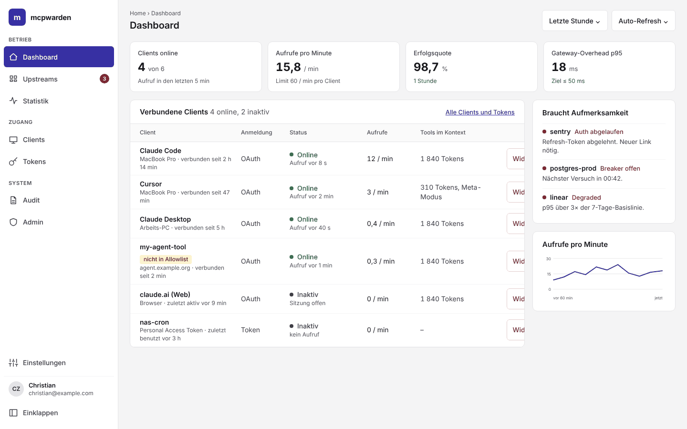 | 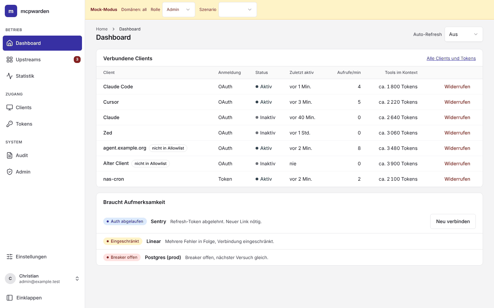 |  |
| 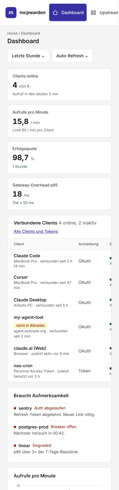 | 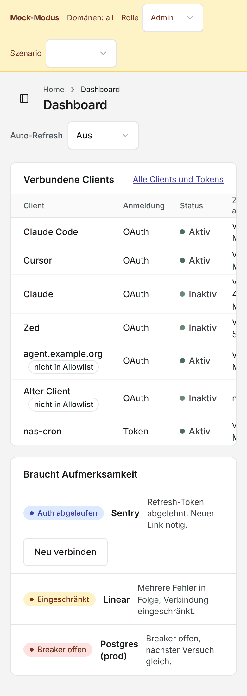 |  |
| 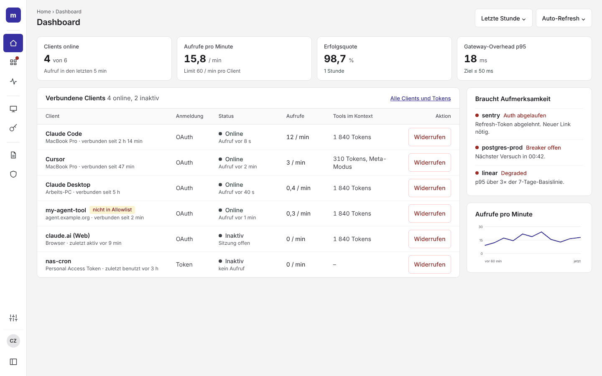 | 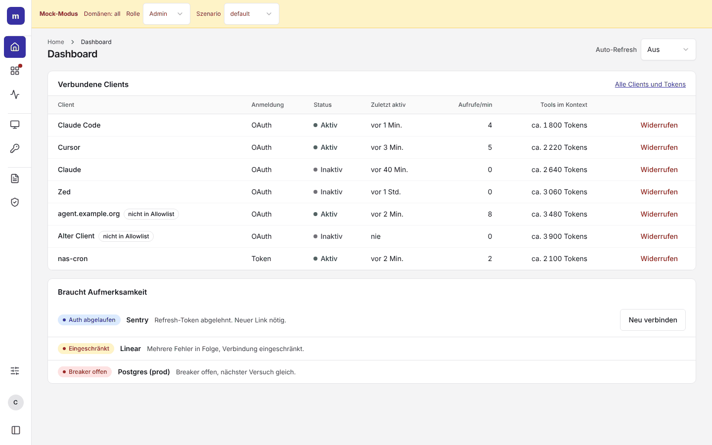 | 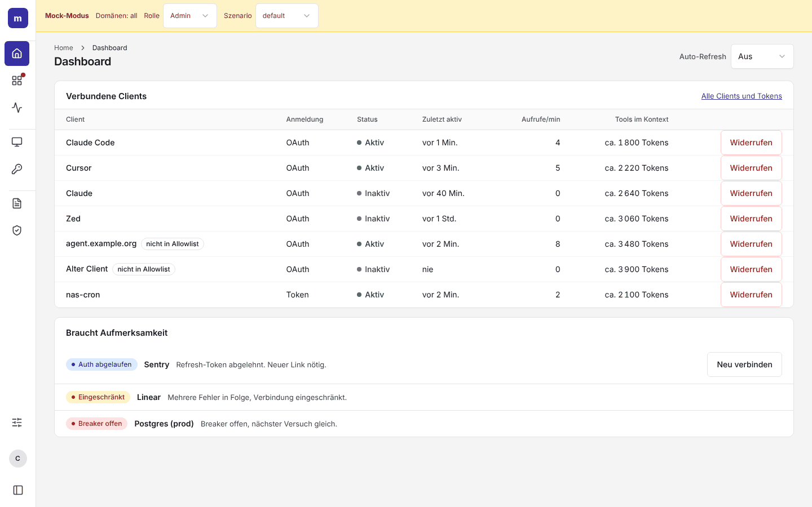 |

| # | Aspect | Finding | Classification | Status |
|---|---|---|---|---|
| D1 | Components | Key-figure row (clients online, calls/min, success rate, overhead) and chart "Aufrufe pro Minute" are missing | deliberate (ui-comparison) | Decision 4: KPIs and chart only with phase 2 |
| D2 | Components | Time window "Letzte Stunde" in the header is missing | deliberate (ui-comparison) | depends on the KPIs (phase 2) |
| D3 | Copy | Status "Online/Inaktiv", "verbunden seit", "Sitzung offen" replaced by "Aktiv/Inaktiv" and column "Zuletzt aktiv" | deliberate (ui-comparison) | W7 |
| D4 | Copy | Device names ("MacBook Pro") are missing, the row shows the redirect host | deliberate (ui-comparison) | Decision 7 |
| D5 | Components | "Widerrufen" as a text link without border instead of an outlined 44 px button (same pattern on clients, tokens, admin) | fix | fixed (ee12262) |
| D6 | Layout | "Braucht Aufmerksamkeit" sits below the table, in the draft as a side column on the right | decision needed | **implemented (5fe9271)**: "Braucht Aufmerksamkeit" above the clients table while there is at least one item, hidden when empty; page empty state unchanged. Side column with the KPI row: phase 2, see [backlog](backlog/ui-deferred.md#d6-phase-2-attention-card-beside-the-kpi-row). (was: open: sensible with the KPI row and chart (phase 2), useless before) |
| D7 | Components | Addition "Neu verbinden" per row of the attention card (draft only a link) | deliberate (ui-comparison) | Spec P0-13, comparison section 2 |

### Upstreams (list)

Draft: `Main.dc.html` · Route: `/upstreams`

| Draft | Implementation before | Implementation after |
|---|---|---|
| 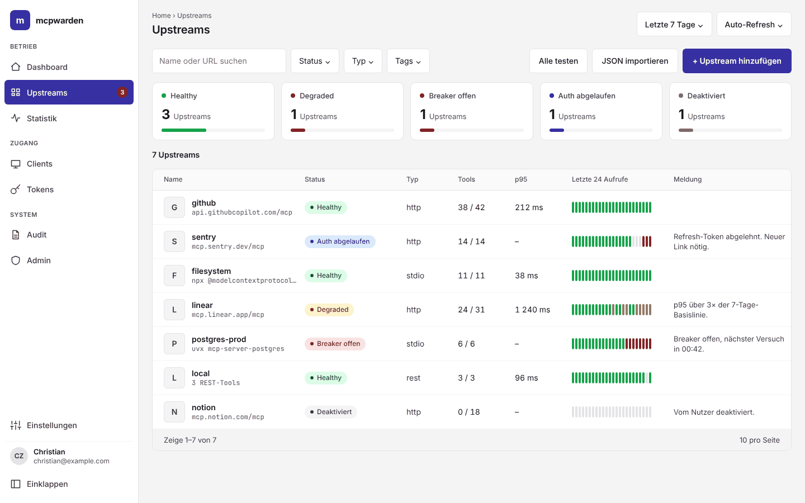 | 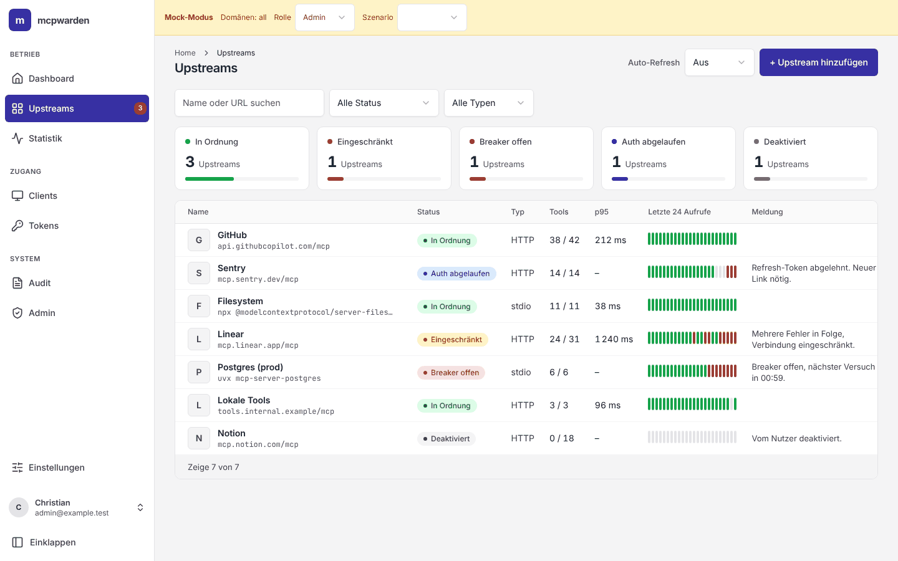 | 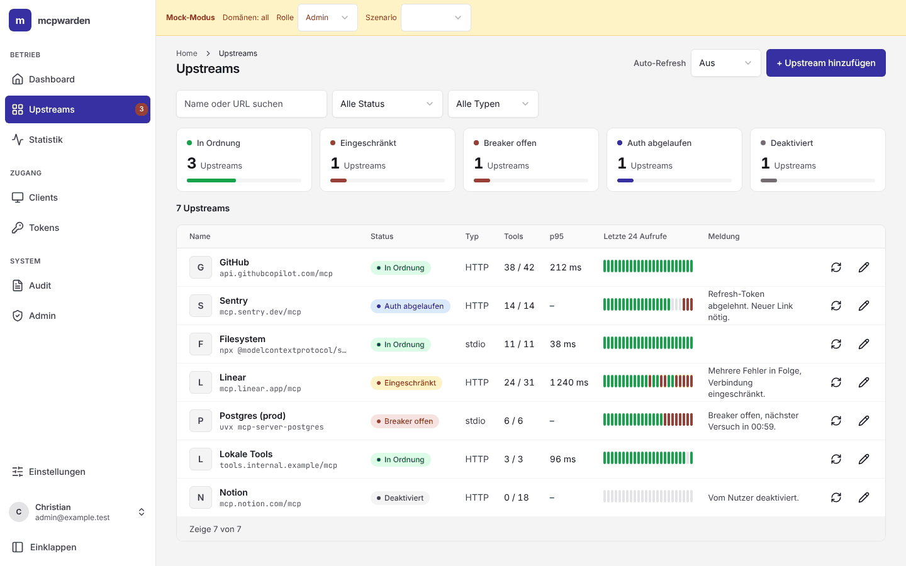 |
| 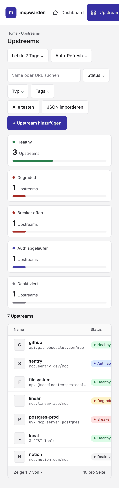 | 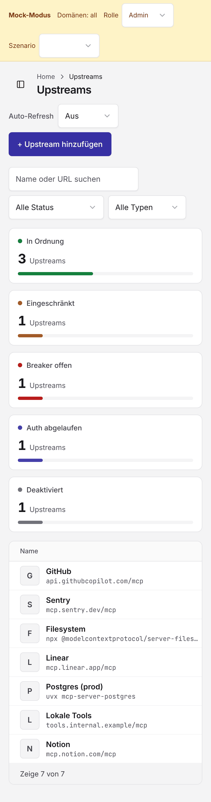 | 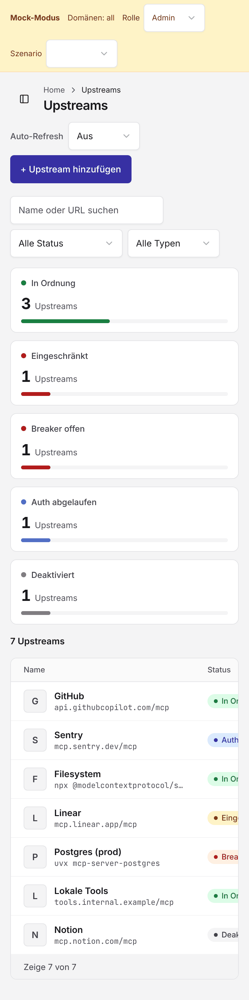 |

| # | Aspect | Finding | Classification | Status |
|---|---|---|---|---|
| U1 | Components | Filter "Tags" is missing | deliberate (ui-comparison) | Decision 7 |
| U2 | Components | "Alle testen" is missing | deliberate (ui-comparison) | Decision 7: later with confirmation and rate hint |
| U3 | Components | "JSON importieren" is missing | deliberate (ui-comparison) | Phase 3 |
| U4 | Components | Time window "Letzte 7 Tage" in the header is missing | decision needed | **deferred -> [backlog](backlog/ui-deferred.md#u4-time-window-letzte-7-tage-in-the-upstream-list)**: Nothing in the list depends on a window; revisit with phase 2 statistics. (was: Effect on the list unclear (comparison item 8)) |
| U5 | Layout | At 1440 px the table was 1264 px wide with 1126 px of space: the action column (test, edit) sat invisibly behind the edge | fix | fixed (ab71269), test mockup-parity |
| U6 | Copy | Count line "7 Upstreams" above the table was missing | fix | fixed (ab71269) |
| U7 | Components | Footer "Zeige 1–7 von 7 · 10 pro Seite": paging is missing | decision needed | **deferred -> [backlog](backlog/ui-deferred.md#u7-paging-footer-in-the-upstream-list)**: Limit of 50 upstreams; revisit when the limit is raised. (was: open: with 50 upstreams (limit) paging can be dispensed with) |
| U8 | Copy | Status labels "In Ordnung/Eingeschränkt" instead of "Healthy/Degraded"; type "HTTP" instead of "http"; type "rest" missing | deliberate (ui-comparison) | W1, phase 1 |
| U9 | A11y | Name link of the row only 36 px high | fix | fixed (ab71269) |

### Upstream detail

Draft: `Detail.dc.html` · Route: `/upstreams/up_4`

| Draft | Implementation before | Implementation after |
|---|---|---|
| 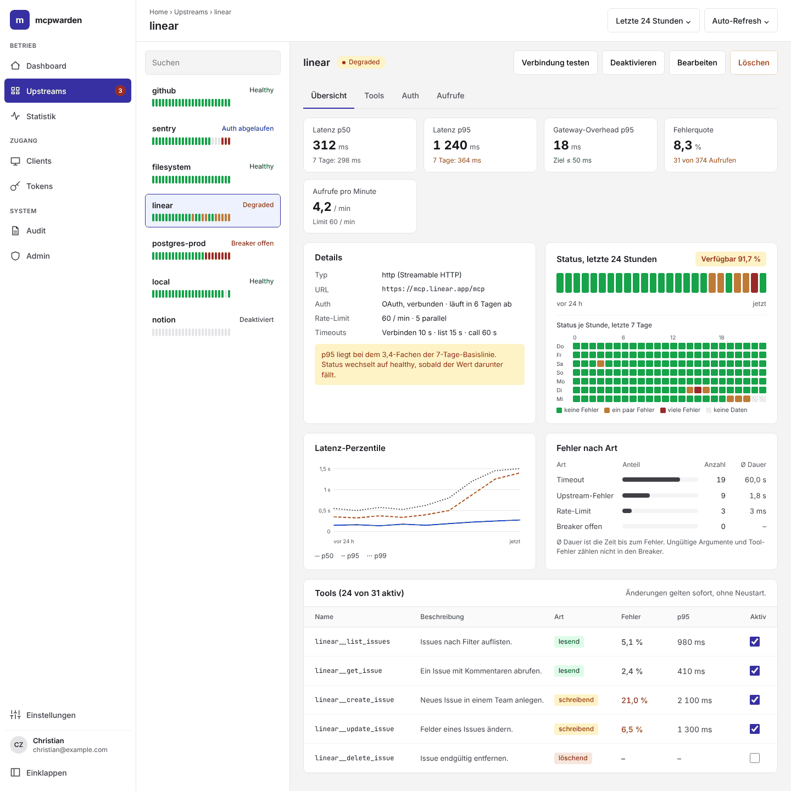 |  | 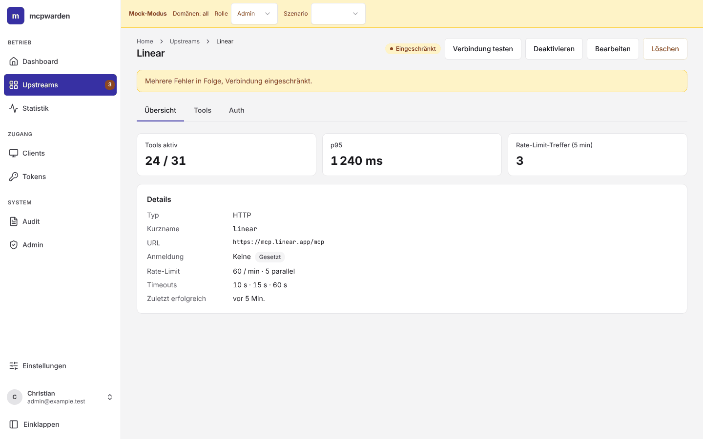 |
| 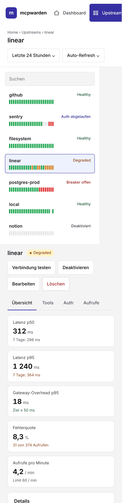 | 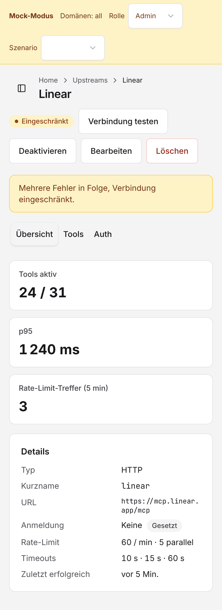 | 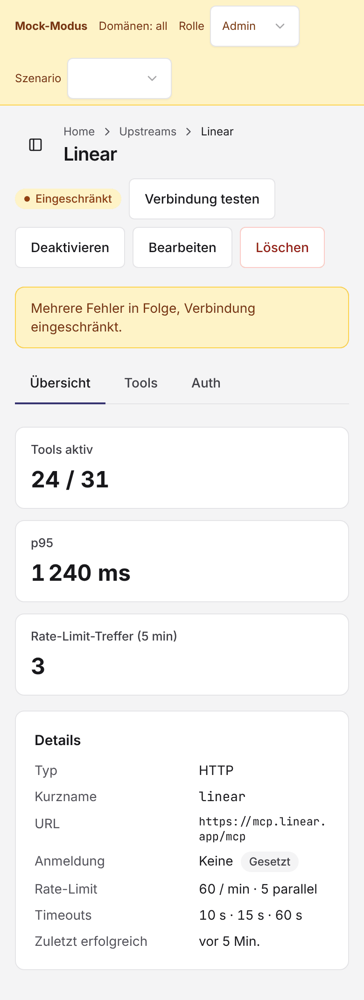 |

| # | Aspect | Finding | Classification | Status |
|---|---|---|---|---|
| T1 | Components | Upstream list with 24 bars to the left of the detail is missing | decision needed | **deferred -> [backlog](backlog/ui-deferred.md#t1-upstream-list-with-24-h-bars-left-of-the-detail)**: Bars need `health-history` (phase 2). (was: open: navigation detail to detail; bars need phase 2) |
| T2 | Components | Key figures p50, overhead, error rate, calls/min; latency chart; "Fehler nach Art"; columns errors/p95 per tool | deliberate (ui-comparison) | Phase 2 (comparison no. 14) |
| T3 | Components | "Status, letzte 24 Stunden", availability and heatmap are missing | deliberate (ui-comparison) | Decision 7: only with `health-history` from phase 2 |
| T4 | Components | Tab "Aufrufe" is missing | deliberate (ui-comparison) | P1 call log, not stored |
| T5 | Copy | Warning box shows the server's `statusReason`, not the fixed baseline text | deliberate (ui-comparison) | W10 |
| T6 | Components | Tabs as a 40 px pill instead of an underline in the accent color at 44 px | fix | fixed (ab71269), test mockup-parity |
| T7 | Layout | Status chip sits on the right in the page header, in the draft next to the heading in the content | decision needed | **implemented (e58b0f1)**: Status chip next to the heading via the `status` slot of `PageHeader`; actions stay on the right. (was: open, purely visual) |
| T8 | Layout | Tools table lies in the tab "Tools", in the draft below the overview | decision needed | **decided, keep**: Tools stay in their own tab: the catalog can hold up to 2000 tools and is loaded lazily, so it does not belong below the overview. (was: open: the draft names the tab "Tools" as not worked out) |
| T9 | Data | Mock seed: linear shows "Anmeldung Keine" with badge "Gesetzt" (secret without auth kind) | fix | fixed (mocks/seed.ts) |

### Add upstream

Draft: `UpstreamNeu.dc.html` · Route: `/upstreams/new`

| Draft | Implementation before | Implementation after |
|---|---|---|
| 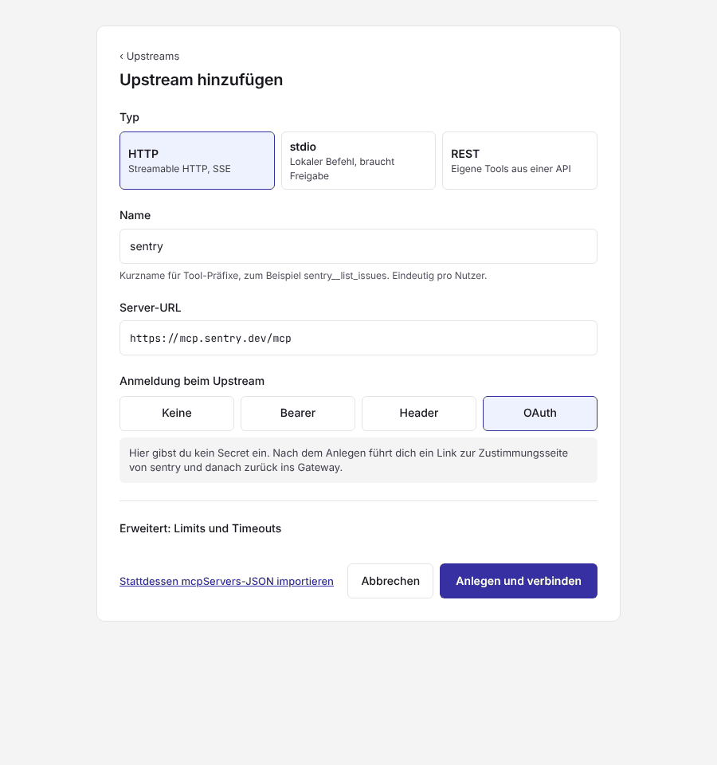 | 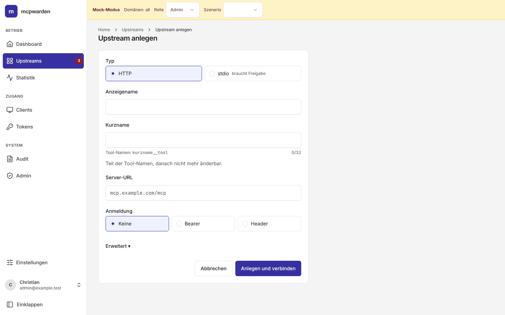 | 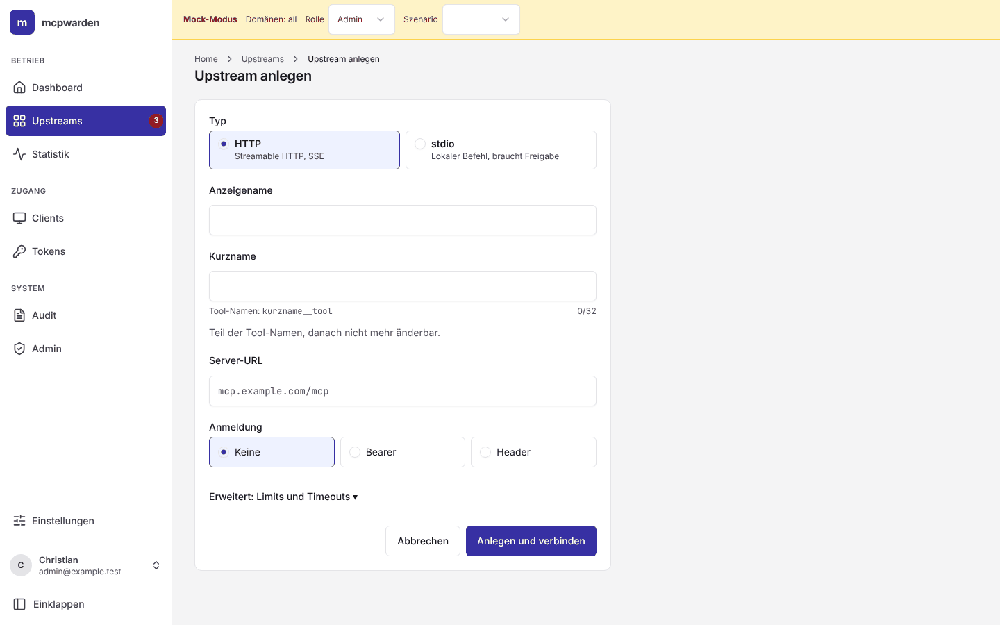 |

| # | Aspect | Finding | Classification | Status |
|---|---|---|---|---|
| N1 | Layout | Form lies in the app shell with breadcrumbs instead of a free-standing card | deliberate (ui-comparison) | frontend.md route map, the page belongs to the navigation |
| N2 | Components | Type REST and sign-in OAuth are missing, default is "Keine" | deliberate (ui-comparison) | Phase 1, comparison no. 17 |
| N3 | Copy | Two fields "Anzeigename" and "Kurzname" with preview `kurzname__tool` and counter instead of one field "Name" | deliberate (ui-comparison) | W6 |
| N4 | Components | Type tiles without description ("Streamable HTTP, SSE", "Lokaler Befehl, braucht Freigabe") | fix | fixed (ab71269) |
| N5 | Copy | "Erweitert" instead of "Erweitert: Limits und Timeouts" | fix | fixed (ab71269) |
| N6 | Components | Link "mcpServers-JSON importieren" is missing | deliberate (ui-comparison) | Phase 3 |

### stdio approval

Draft: `StdioFreigabe.dc.html` · Route: `/upstreams/up_5/approve`

| Draft | Implementation before | Implementation after |
|---|---|---|
| 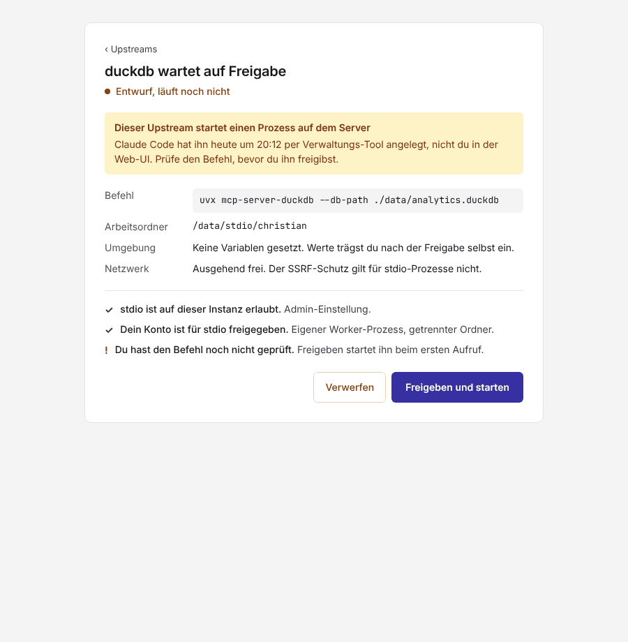 | 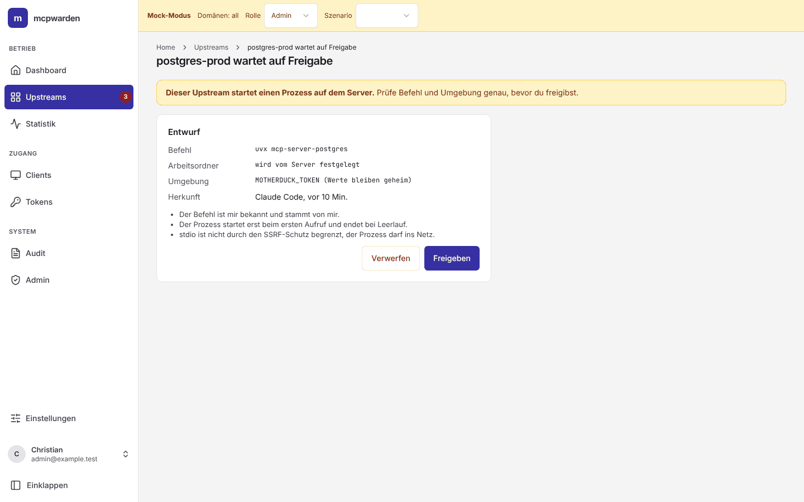 |  |

| # | Aspect | Finding | Classification | Status |
|---|---|---|---|---|
| ST1 | Layout | Warning as a banner above a card "Entwurf" in the app shell, title "… wartet auf Freigabe" identical | deliberate (ui-comparison) | same elements, different arrangement (app shell) |
| ST2 | Copy | Button "Freigeben" instead of "Freigeben und starten" | deliberate (ui-comparison) | comparison no. 21: the process starts lazily |
| ST3 | Copy | Working folder "wird vom Server festgelegt" instead of `/data/stdio/christian` | deliberate (ui-comparison) | W14 |
| ST4 | Components | Checklist without check mark/exclamation mark per prerequisite (stdio global, account approved, command checked) and without block reasons | decision needed | **implemented (6884a9a)**: Checklist with icon and text per row and block reasons from `/api/me/capabilities`; approval is disabled while stdio is blocked. (was: open: block reasons are delivered by `/api/me/capabilities` (comparison section 2)) |

### Auth link: enter token

Draft: `AuthLink.dc.html` · Route: `/link/abc`

| Draft | Implementation before | Implementation after |
|---|---|---|
| 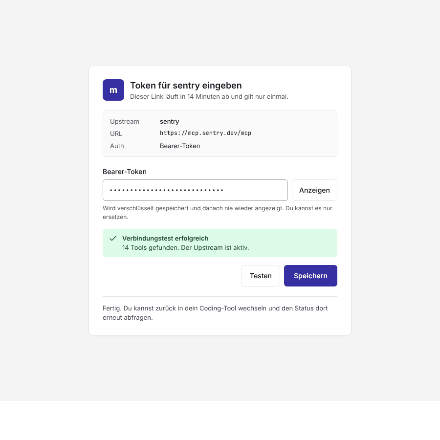 | 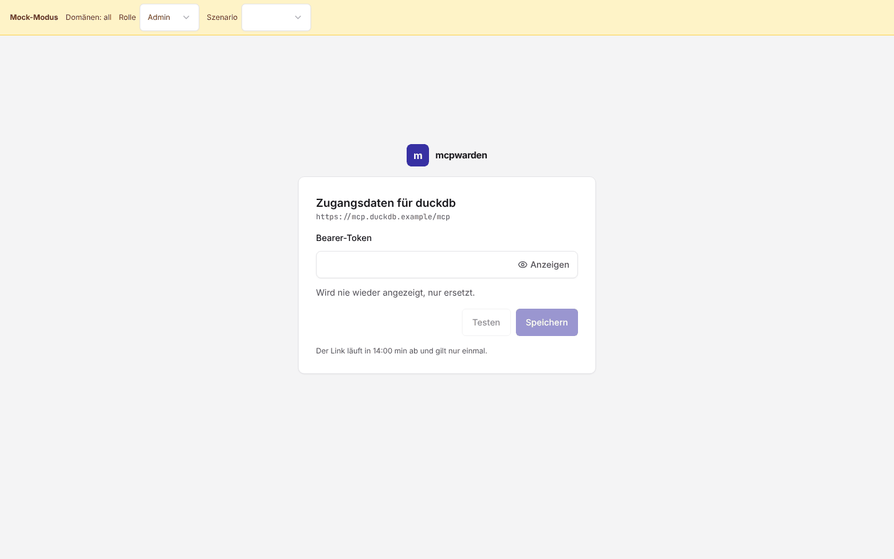 | 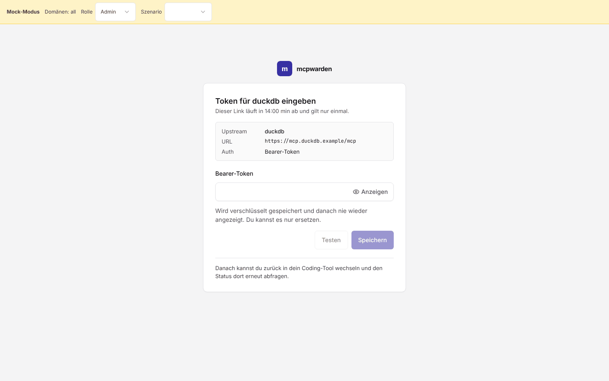 |
| 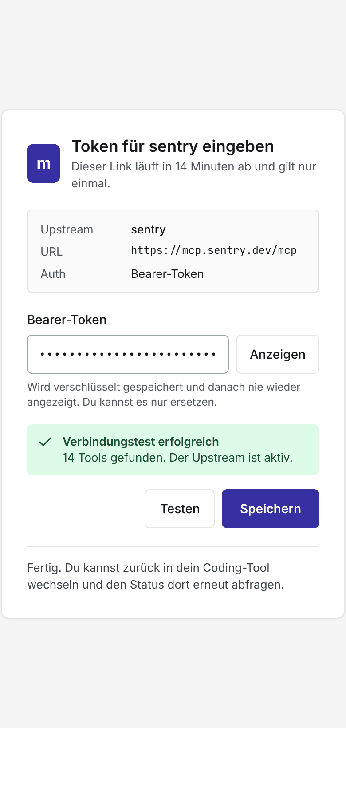 | 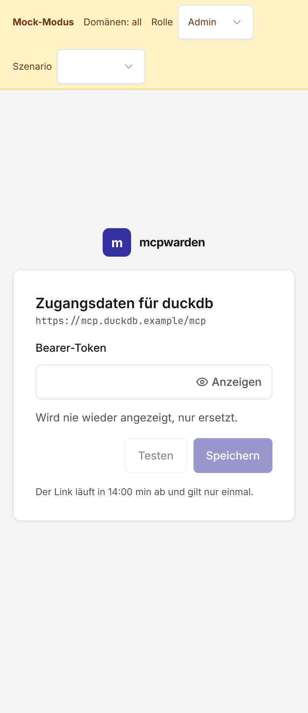 | 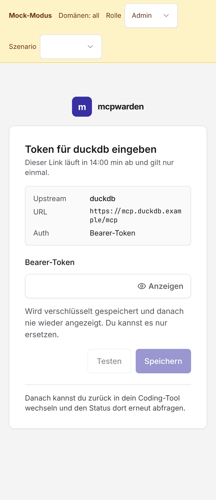 |

| # | Aspect | Finding | Classification | Status |
|---|---|---|---|---|
| A1 | Copy/Layout | Title "Zugangsdaten für duckdb" instead of "Token für sentry eingeben"; remaining time was in the footer; block upstream/URL/auth, success/error box "Verbindungstest erfolgreich" and footer hint "zurück ins Coding-Tool" were missing; hint "Wird verschlüsselt gespeichert …" shortened | fix | fixed (03e3516), test mockup-parity |
| A2 | Components | Input field is empty, the draft shows an example token | deliberate (ui-comparison) | comparison no. 22 |
| A3 | Layout | Logo stands above the card (shared auth layout), in the draft inside the card | deliberate (ui-comparison) | layout `auth` also applies to login/consent |

### OAuth consent

Draft: `Consent.dc.html` · Route: `/consent?client_id=agent-x&sig=ok`

| Draft | Implementation before | Implementation after |
|---|---|---|
| 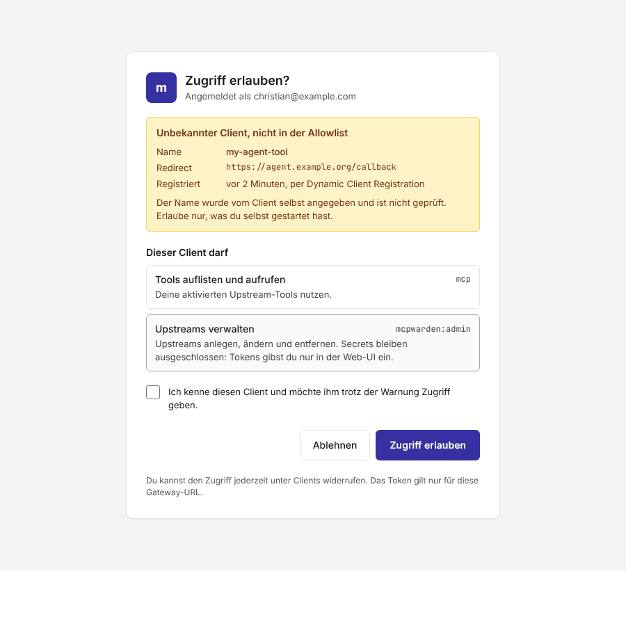 | 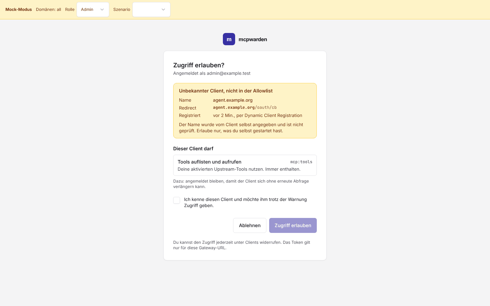 |  |
| 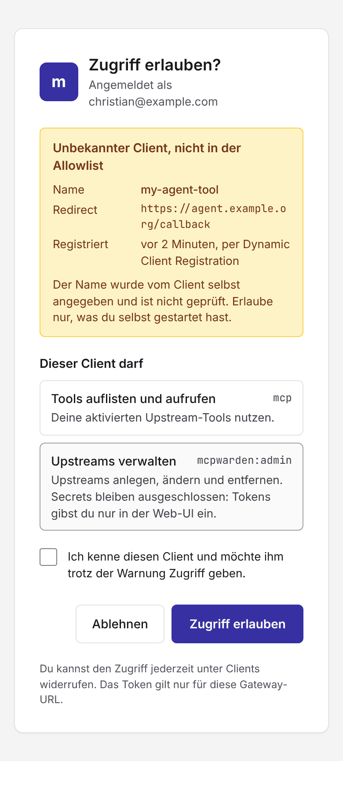 | 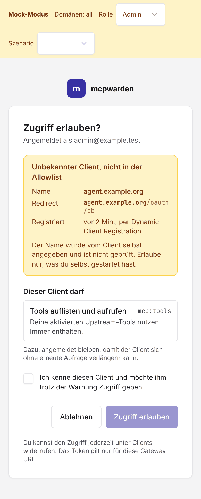 |  |

| # | Aspect | Finding | Classification | Status |
|---|---|---|---|---|
| C1 | Components | Scope `mcpwarden:admin` is missing | deliberate (ui-comparison) | Decision 5: hidden until phase 2 |
| C2 | Copy | Scope name `mcp:tools` instead of `mcp`, additional line "angemeldet bleiben" | deliberate (ui-comparison) | W2 |
| C3 | Layout | Logo above the card (like A3); time "vor 2 Min." instead of "vor 2 Minuten" | deliberate (ui-comparison) | shared layout, short format of the app |

### Statistics

Draft: `Statistik.dc.html` · Route: `/stats`

| Draft | Implementation before | Implementation after |
|---|---|---|
| 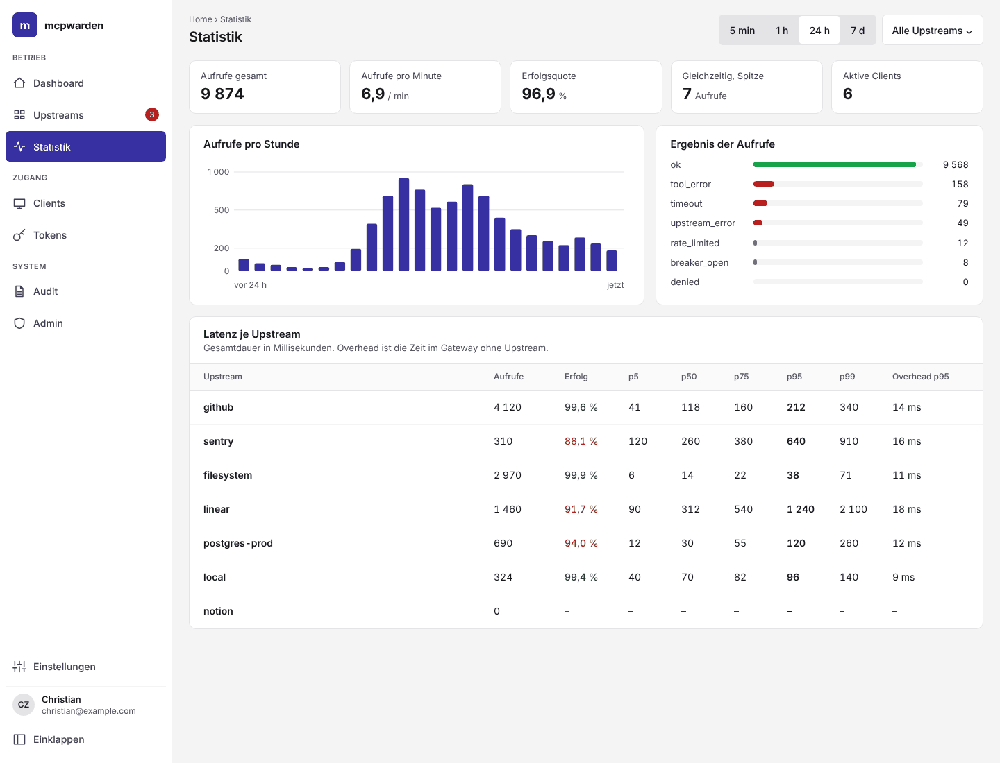 | 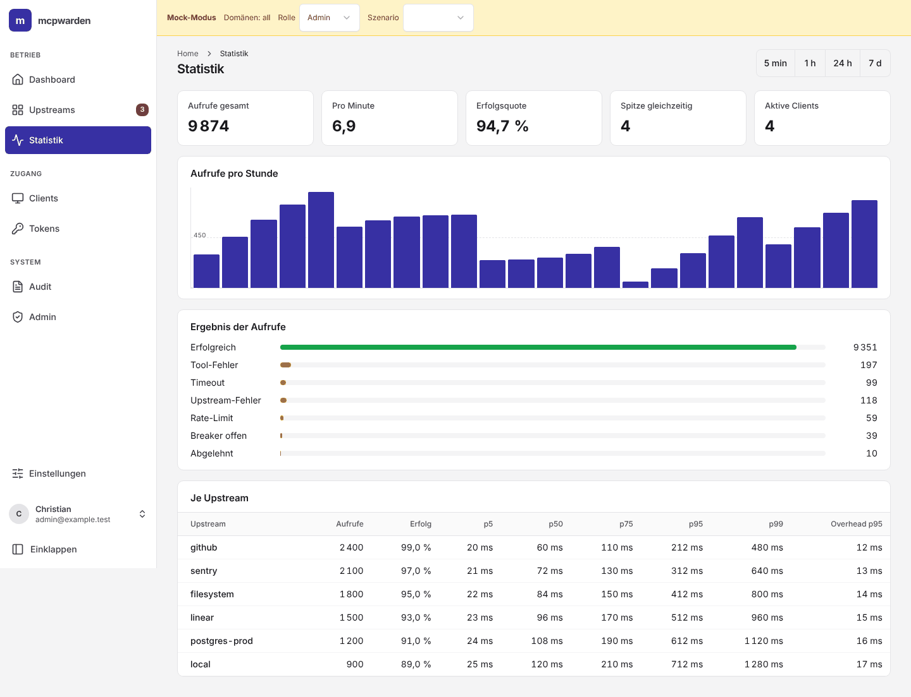 | 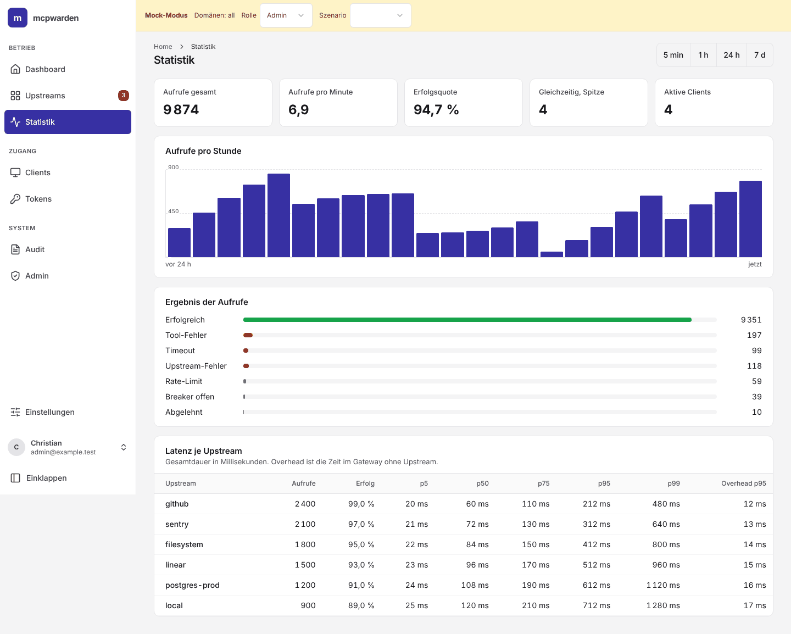 |

| # | Aspect | Finding | Classification | Status |
|---|---|---|---|---|
| S1 | Components | Column chart without time axis ("vor 24 h" / "jetzt"), top grid value cut off | fix | fixed (03e3516), test mockup-parity |
| S2 | Colors | All error bars orange; draft: timeout/upstream error red, limits gray (text still carries the meaning) | fix | fixed (03e3516) |
| S3 | Copy | Table header "Je Upstream" without subtitle; draft "Latenz je Upstream" with an explanation of the overhead | fix | fixed (03e3516) |
| S4 | Copy | Key figures "Pro Minute", "Spitze gleichzeitig" instead of "Aufrufe pro Minute", "Gleichzeitig, Spitze" | fix | fixed (03e3516) |
| S5 | Copy | Results in German ("Erfolgreich", "Tool-Fehler") instead of raw values `ok`, `tool_error` | deliberate (ui-comparison) | comparison no. 28 |
| S6 | Components | Filter "Alle Upstreams" is missing | decision needed | **deferred -> [backlog](backlog/ui-deferred.md#s6-statistics-filter-alle-upstreams)**: API is ready (`upstream` on `stats/summary`); UI with the phase 2 statistics rework. (was: open: API `stats/summary` knows `upstream`, the UI does not use it) |
| S7 | Data | Grid line "500" in the draft sits at ≈ 615; the implementation computes proportionally | deliberate (ui-comparison) | comparison no. 27 (error in the draft) |

### Clients

Draft: `Clients.dc.html` · Route: `/settings/connections`

| Draft | Implementation before | Implementation after |
|---|---|---|
| 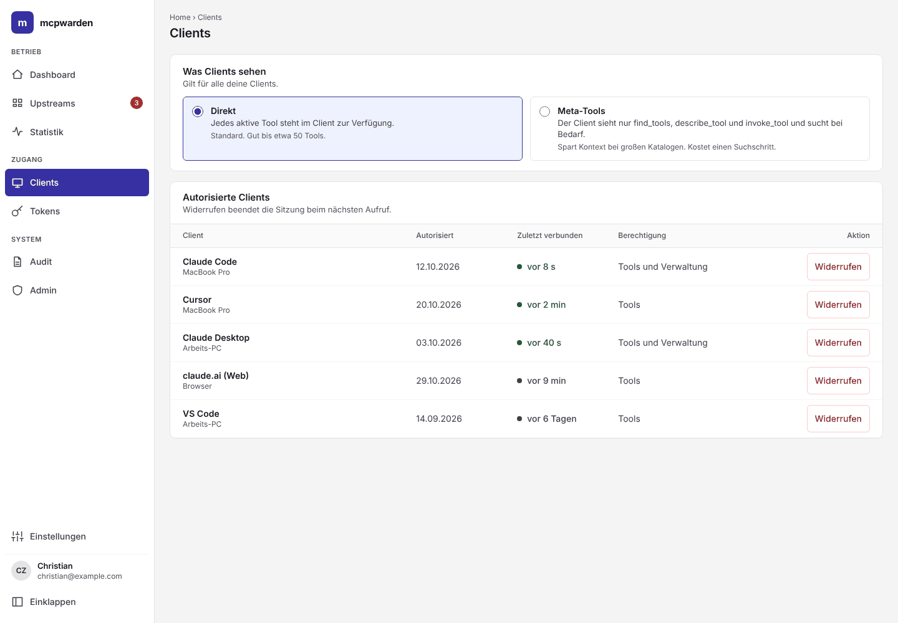 | 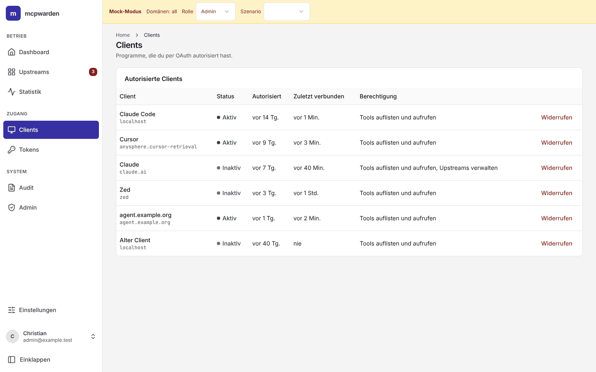 | 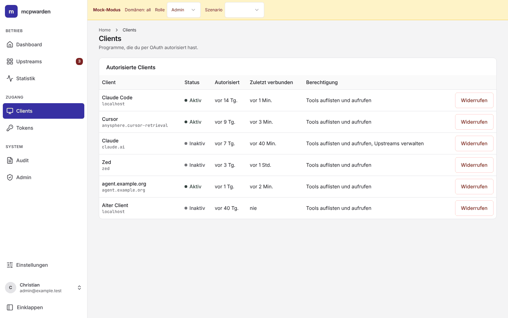 |

| # | Aspect | Finding | Classification | Status |
|---|---|---|---|---|
| CL1 | Components | Card "Was Clients sehen" (Direkt/Meta-Tools) is missing | deliberate (ui-comparison) | Phase 3 |
| CL2 | Copy | Subtitle shows the redirect host instead of the device; column "Status" (Aktiv/Inaktiv) additionally; permission as plain text | deliberate (ui-comparison) | Decision 7, W2, W7 |
| CL3 | Components | "Widerrufen" without border | fix | fixed (see D5) |

### Personal access tokens

Draft: `Tokens.dc.html` · Route: `/settings/tokens`

| Draft | Implementation before | Implementation after |
|---|---|---|
| 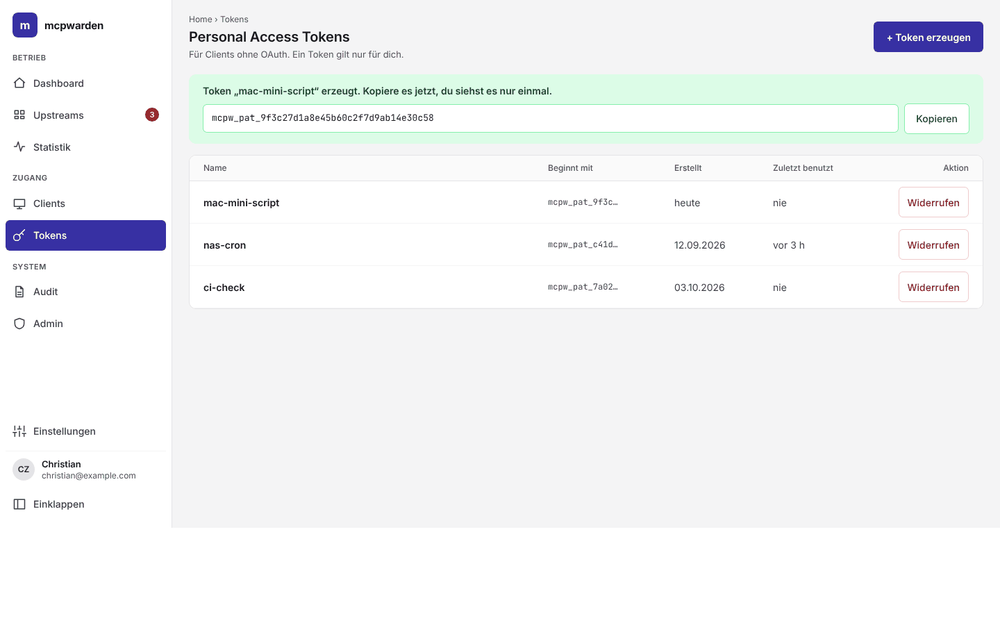 | 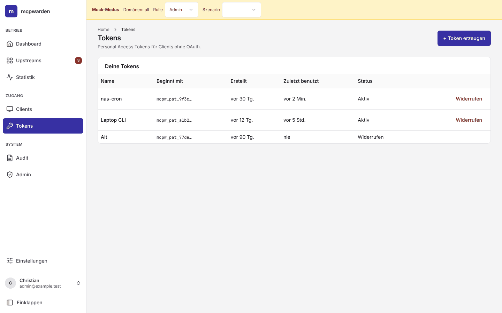 | 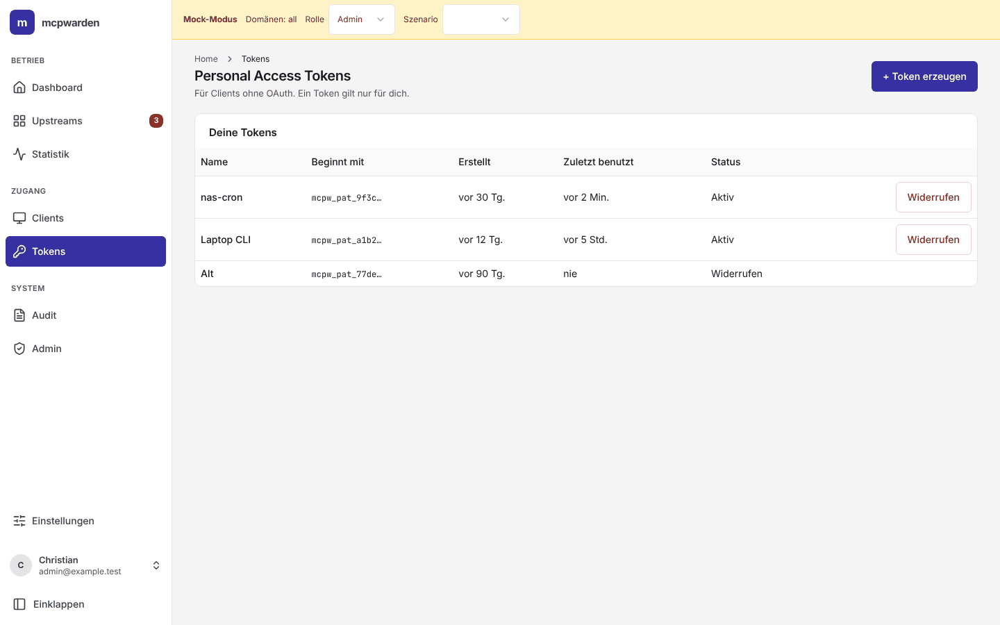 |

| # | Aspect | Finding | Classification | Status |
|---|---|---|---|---|
| TK1 | Copy | Heading "Tokens" instead of "Personal Access Tokens", subtitle different | fix | fixed (ee12262), breadcrumb stays "Tokens" |
| TK2 | Components | "Widerrufen" without border; column "Status" additionally (revoked tokens stay visible) | fix | fixed (see D5); column deliberate |

### Audit log

Draft: `Audit.dc.html` · Route: `/audit`

| Draft | Implementation before | Implementation after |
|---|---|---|
| 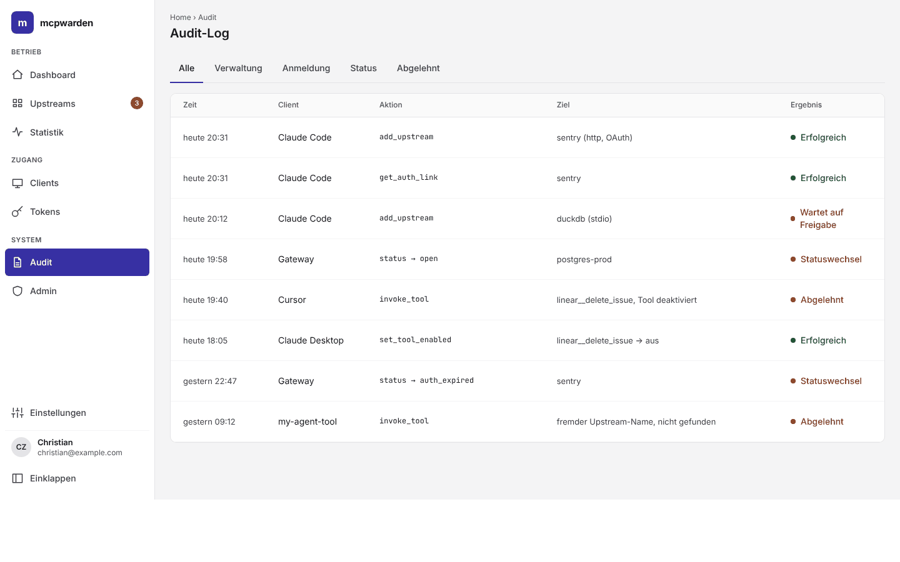 | 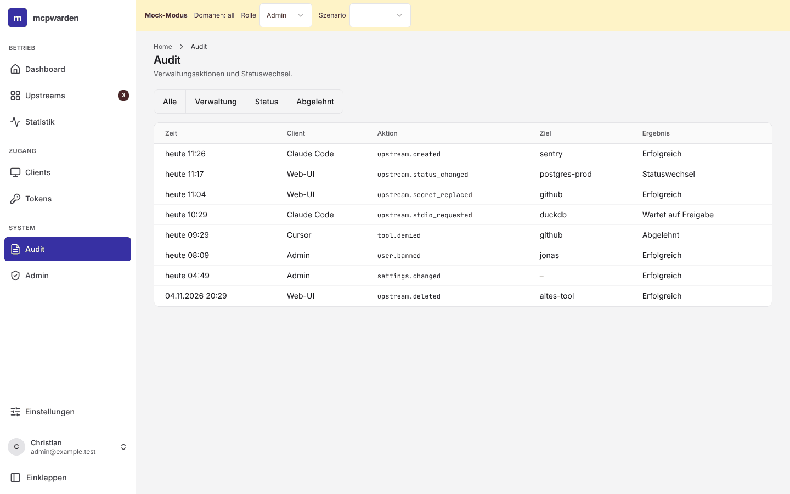 | 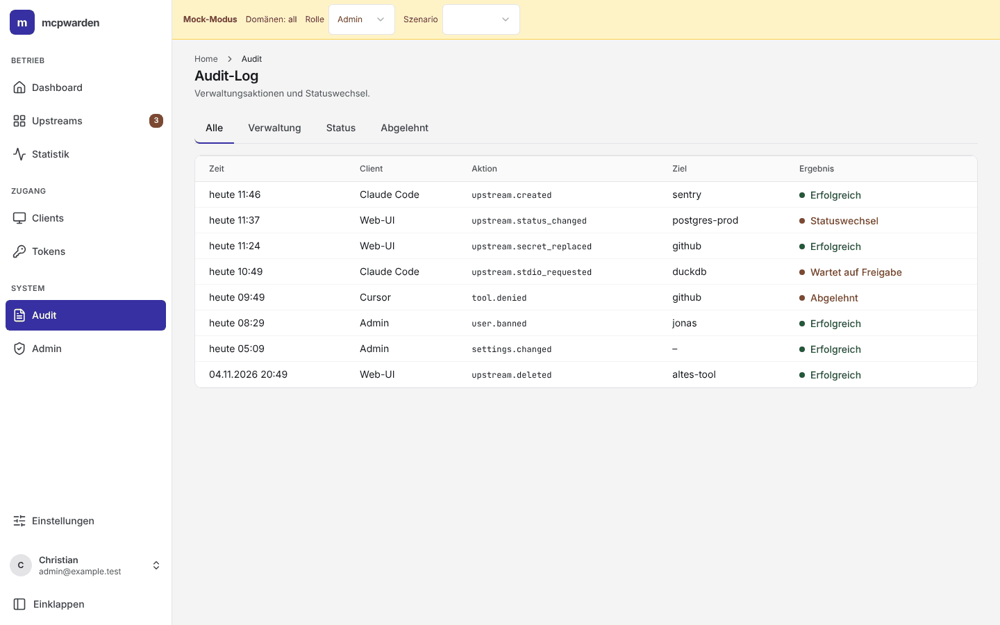 |

| # | Aspect | Finding | Classification | Status |
|---|---|---|---|---|
| AU1 | Copy | Heading "Audit" instead of "Audit-Log" | fix | fixed (ee12262) |
| AU2 | Components | Tab "Anmeldung" is missing | deliberate (ui-comparison) | comparison no. 30: no data source |
| AU3 | Components | Categories as bordered pills instead of an underline, 44 px | fix | fixed (03e3516 / ab71269) |
| AU4 | Colors | Result only as text without dot and status color | fix | fixed (03e3516), test mockup-parity |

### Admin: users and invitations

Draft: `Admin.dc.html` · Route: `/admin/users`

| Draft | Implementation before | Implementation after |
|---|---|---|
| 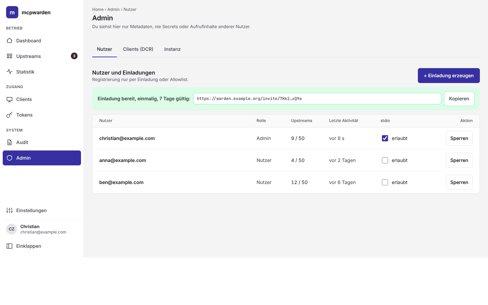 | 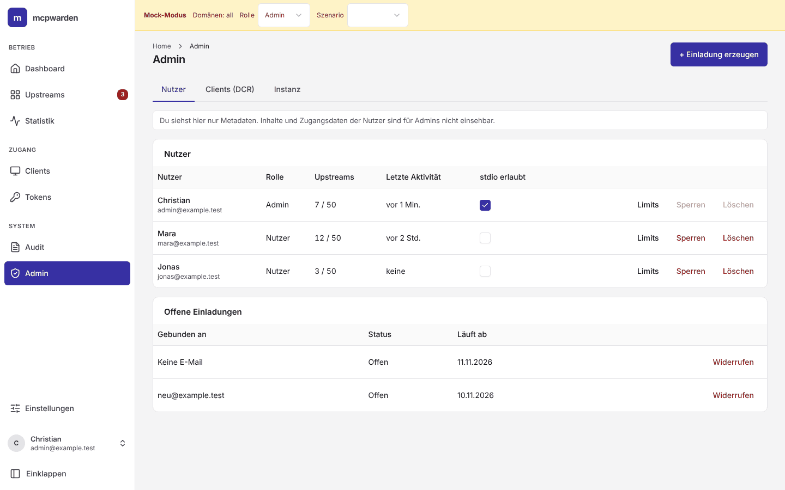 | 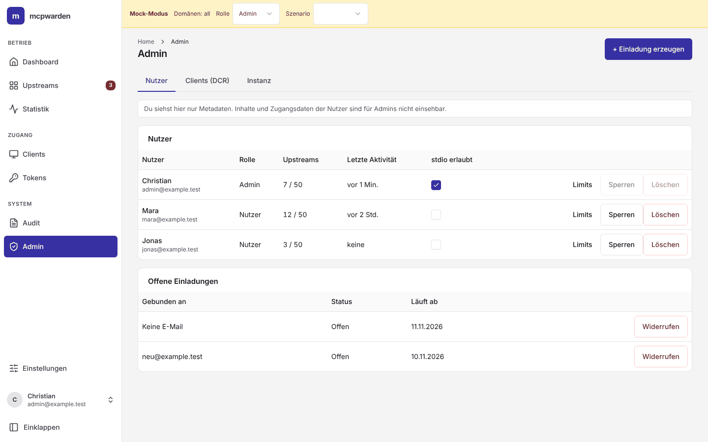 |

| # | Aspect | Finding | Classification | Status |
|---|---|---|---|---|
| AN1 | Components | Additionally limits, delete, unban, list of open invitations | deliberate (ui-comparison) | comparison section 2 (gaps of the draft), W5 |
| AN2 | Copy | Subtitle "Registrierung nur per Einladung oder Allowlist" is missing | deliberate (ui-comparison) | Decision 2 |
| AN3 | Components | "Sperren", "Löschen", "Widerrufen" without border | fix | fixed (see D5) |
| AN4 | Layout | Button "+ Einladung erzeugen" in the page header instead of in the section | decision needed | **implemented (eeb6936)**: "+ Einladung erzeugen" moved into the header of the section "Offene Einladungen". (was: open, purely visual) |

### Admin: clients (DCR)

Draft: `AdminClients.dc.html` · Route: `/admin/oauth`

| Draft | Implementation before | Implementation after |
|---|---|---|
| 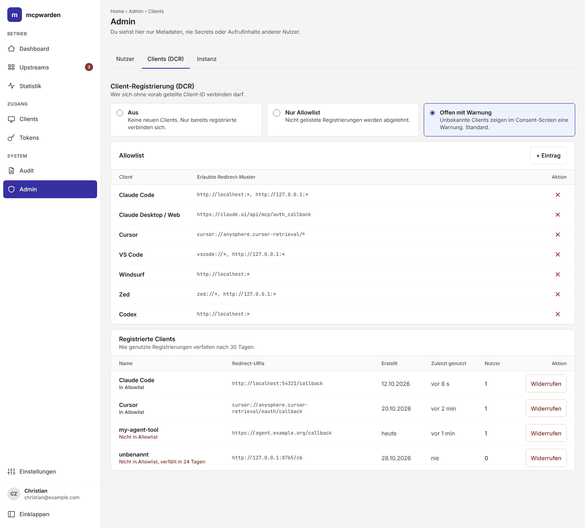 | 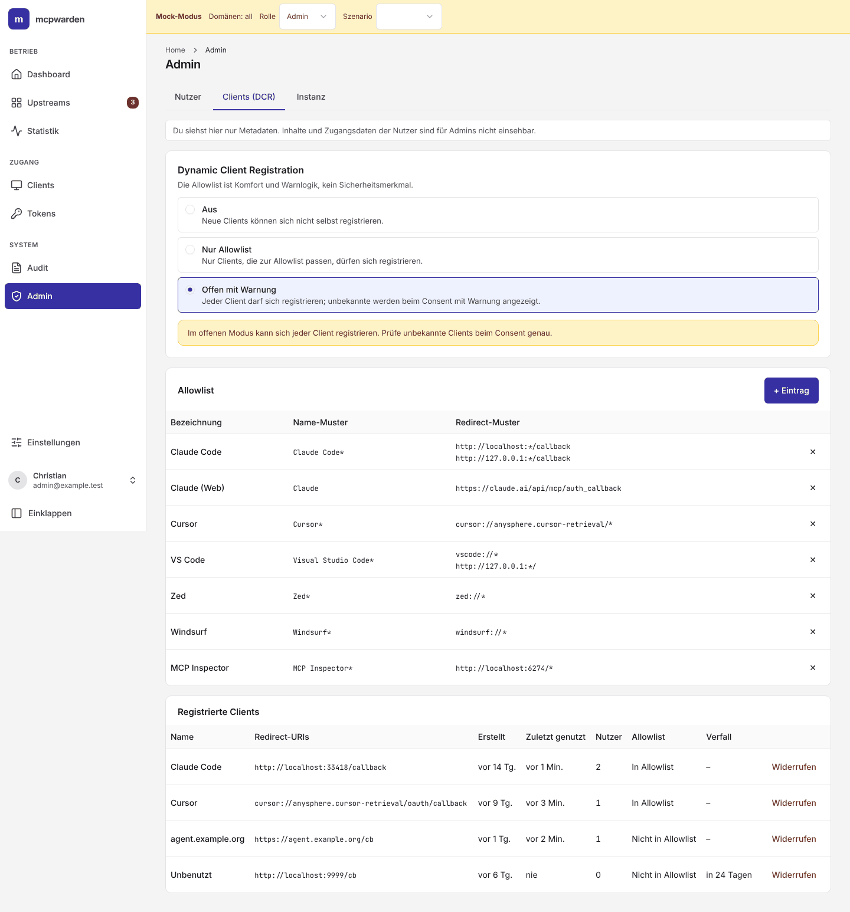 |  |

| # | Aspect | Finding | Classification | Status |
|---|---|---|---|---|
| AC1 | Layout | Mode as a vertical list with its own wording instead of three tiles side by side | decision needed | **decided, keep**: DCR mode stays a radio list with one description per mode. The labels (Aus, Nur Allowlist, Offen mit Warnung) already match the mockup; the descriptions stay because they are more precise. (was: open, purely visual) |
| AC2 | Components | Additional column "Name-Muster", warning box in mode "Offen", columns "Allowlist" and "Verfall" in the client list | deliberate (ui-comparison) | Spec P0-2 |
| AC3 | A11y | Removing "✕" was a small text button without a 44 px area | fix | fixed (ee12262) |
| AC4 | Components | "Widerrufen" without border | fix | fixed (see D5) |

### Admin: instance

Draft: `AdminInstanz.dc.html` · Route: `/admin/settings`

| Draft | Implementation before | Implementation after |
|---|---|---|
|  |  |  |

| # | Aspect | Finding | Classification | Status |
|---|---|---|---|---|
| AI1 | Components | Instead of three boxes: switch for stdio, list "SSRF-Ausnahmen" with "+ Eintrag", hint on registration | deliberate (ui-comparison) | W9, Decision 2 |

### Settings

Draft: `Settings.dc.html` · Route: `/settings`

| Draft | Implementation before | Implementation after |
|---|---|---|
|  |  |  |
|  |  |  |

| # | Aspect | Finding | Classification | Status |
|---|---|---|---|---|
| SE1 | Components | Change email, notifications (3), delete account are missing; there is only the switch "E-Mail bei Statuswechsel" | deliberate (ui-comparison) | Decision 3 (as of 2026-11-05) |
| SE2 | Components | Choice System/Hell/Dunkel is missing | deliberate (ui-comparison) | Decision 8 |
| SE3 | Copy | Sessions without device names ("MacBook Pro"); subtitle with a pointer to clients was missing | fix | fixed (pointer added); device names deliberate (decision 7) |
| SE4 | Components | "Passwort ändern" as a filled primary button, draft: outlined | fix | fixed (03e3516) |
| SE5 | A11y | Switch "Anzeigen" in the password field only 24 px high (AA minimum size met, target of the plan 44 px) | decision needed | **implemented (f9b0297)**: Input group 44 px, toggle hit area 44 px, icon stays 16 px; target-size check in `mockup-parity.spec.ts`. (was: open: input group 44 px, inner button smaller) |

## Decisions of the owner (2026-11-05)

All 11 items that were open have been decided. The original finding texts stay in the tables above; the resolution is in the Status column of each row (the earlier status is kept after "was:").

| Item | Page | Resolution |
|---|---|---|
| D6 | Dashboard | implemented (5fe9271); side column with the KPI row in phase 2, see [backlog](backlog/ui-deferred.md#d6-phase-2-attention-card-beside-the-kpi-row) |
| U4 | Upstreams (list) | deferred -> [backlog](backlog/ui-deferred.md#u4-time-window-letzte-7-tage-in-the-upstream-list) |
| U7 | Upstreams (list) | deferred -> [backlog](backlog/ui-deferred.md#u7-paging-footer-in-the-upstream-list) |
| T1 | Upstream detail | deferred -> [backlog](backlog/ui-deferred.md#t1-upstream-list-with-24-h-bars-left-of-the-detail) |
| T7 | Upstream detail | implemented (e58b0f1) |
| T8 | Upstream detail | decided, keep: tools stay in their own tab (catalog up to 2000 tools, lazy load) |
| ST4 | stdio approval | implemented (6884a9a) |
| S6 | Statistics | deferred -> [backlog](backlog/ui-deferred.md#s6-statistics-filter-alle-upstreams) |
| AN4 | Admin: users and invitations | implemented (eeb6936) |
| AC1 | Admin: clients (DCR) | decided, keep: radio list with a description per mode; labels already match the mockup |
| SE5 | Settings | implemented (f9b0297) |

Count: 5 implemented (D6, T7, ST4, AN4, SE5), 2 decided and kept (T8, AC1), 4 deferred (U4, U7, T1, S6) = 11. Deferred items live in [`backlog/ui-deferred.md`](backlog/ui-deferred.md).

## Open decisions

None. All 11 items are resolved (implemented, decided or deferred to the backlog).

## Tests

New: `tests/ui/e2e/mockup-parity.spec.ts` (structural checks without pixel snapshots: table without horizontal scrolling at 1440 px and reachable 44 px actions, tabs 44 px with a 2 px underline in `--primary`, outlined row actions, audit result with dot and text, statistics time axis and title, auth-link header, type tiles, page titles). Existing tests stayed unchanged; their expectations ("Tokens", "Audit" as part of the heading) still hold.
